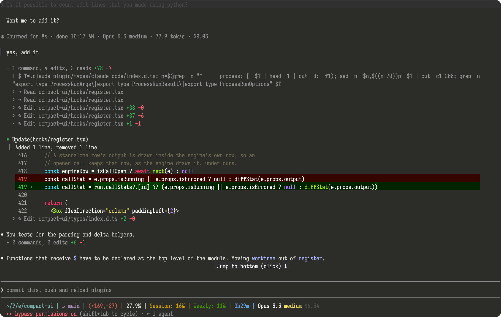

# compact-ui

A Claude Code mod that gives the transcript an opencode-style compact look.



- Tool calls between replies fold into one line: `+ 3 commands, 2 edits, 1 thought (1 failed) +78 -7`.
- The line starts with `~` while running; click it to list each call and thought, click again to fold all.
- `+N -M` counts lines changed: edits from their patch, Bash commands from the git work tree.
- Failed calls show in red. Claude Code's own groups of reads and searches fold the same way.
- Click a call to open Claude Code's own row for it, and its line again to fold it.
- A thought shows a few words; click it for the full text.
- `/fold` expands or folds every run at once.
- Your prompts get a purple left bar.
- Runs right under reply text, and the turn line, get a blank line above.
- The turn line adds end time, model, effort, tok/s and cost:
  `✻ Baked for 16s · done 9:21 AM · Opus 5.5 high · 19.5 tok/s · $0.42`.

Clicking needs Claude Code's fullscreen mode.

## Install

At the prompt of a terminal session:

```
/plugin install compact-ui --marketplace wKich/compact-ui
```

Answer `y` to add the marketplace, then pick a scope.

From a shell:

```
claude plugin install compact-ui --marketplace wKich/compact-ui
```

In the desktop app, where `/plugin` does not run: click + next to the prompt box, then Plugins, Add marketplace with `wKich/compact-ui`, then Add plugin.
